## What the stack does

The aim of #116 is to get logic out of `NiceGuiNode` (`ui_node.py`) into layers. On `caatinga-dev` it was 4,195 lines. On `ui-116-run-plan-sim-system` (head `caa70b9`) it is 1,589. On `ui-116-Plan-service-fixes` it is 838.

| PR | Change |
|---|---|
| #152 Alan services | Drive, robot brain, row discovery and navigation as domain services, application services and view models |
| #153 Telemetry | Odometry and GPS state moves into `TelemetryDomainService`, `TelemetryApplicationService` and `TelemetryViewModel` |
| #156 Topo rows | Row geometry, contour planning, row building and repair become pure modules (`row_planning`, `topo_row_builder`, `plan_import`), with regression tests |
| #158 RosGateway | Subscriptions, timers and tool publishers go through `RosGateway`. The mission executor moves into `MissionDomainService`, and `ObstacleManager` and `MissionStore` use the gateway too |
| #161 Obstacles | `ObstacleViewModel`, and the obstacle cards move to `pages/obstacle_cards.py`. Saved missions sit behind `MissionViewModel` |
| #162 Topology edits | `TopologyEditService` holds the rules for dropping a node, saving F2C rows, repairing and deleting. The node methods become thin wrappers |
| #163 Sim assets | `SimAssetService` handles crop-model upload validation and writing, plus the soil zip import |
| Branch `ui-116-run-plan-sim-system` (PR number to add) | UI split into Run, Plan, Sim and System tabs. `SimPage` and `SystemPage` are classes with their cards under `pages/sim/` and `pages/system/`. `SimWorldService` rebuilds the Gazebo world. Tool processes move into `process_registry`. Map archive goes behind `TopologyViewModel`. Layer rules are enforced with import-linter in CI (six contracts). 57 test files |
| Branch `ui-116-Plan-service-fixes` (PR number to add) | `PlanApplicationService` plans rows, imports plans and saves them. It returns plain data and keeps no draft. `PlanViewModel` words the status and opens a `PlanPageState` per browser session (boundary, draft, status, button state). The Plan tab is `PlanPage`, with its cards under `pages/plan/`: boundary map, controls, repair dialog, mission queue, mission store. A planning result that arrives after Clear is discarded. A seventh import-linter contract keeps the node, pages and view models off the F2C planner, `row_planning` and `plan_import` |

#155 (optical flow in Docker) and #157 (vendored skills) are unrelated to the refactor.

The three items listed as outstanding in the 9 October comment are done: the subscription, timer and tool publishers go through `RosGateway`, the mission executor is in `MissionDomainService`, and the F2C-to-topo glue is in `TopologyEditService.stage_f2c_save`.

## Diagram as built

Solid arrows follow the dependency rule. Dashed arrows and red dashed boxes are known deviations, each listed under "Still open" below. The dotted arrows labelled "callback" and "live doc getter" are runtime callbacks.

```mermaid
flowchart TB
  subgraph P1["Phase 1: same NiceGUI ROS node (NiceGuiNode, ui_node.py, 838 lines)"]
    subgraph UI["View (NiceGUI)"]
      Content["content(): four tabs"]
      RunTab["Run tab<br/>_run_content (method on node, ~110 lines)"]
      PlanPage["PlanPage (class)"]
      SimPage["SimPage (class)"]
      SystemPage["SystemPage (class)"]
      RunCards["pages/run cards<br/>(drop node, joystick, track,<br/>row discovery, node map, sidebar)"]
      PlanCards["pages/plan cards<br/>(boundary map, controls, repair dialog,<br/>mission queue, mission store)"]
      SimCards["pages/sim cards<br/>(plant placement, Gazebo, row follow,<br/>soil texture, map archive)"]
      SysCards["pages/system cards<br/>(odometry, battery, safety, ESP, GPS, tools)"]
      ObsCards["pages/obstacle_cards"]
    end

    subgraph PROC["Process helper (UI-neutral, no ROS)"]
      ProcReg["process_registry<br/>(RViz, Gazebo, explorer, grapher, neo;<br/>shared across browser sessions)"]
      Medkit["Medkit launch<br/>(subprocess in tools_card)"]
    end

    subgraph VM["ViewModel (UI state and user intent)"]
      GlobalVM["GlobalViewModel"]
      RunVM["RunViewModel<br/>(drive, row discovery, navigation)"]
      TopoVM["TopologyViewModel<br/>(mirrors the live TopoDoc, map archive)"]
      TelemetryVM["TelemetryViewModel"]
      RobotBrainVM["RobotBrainViewModel"]
      PlanVM["PlanViewModel<br/>(plan status wording, PlanPageState per session)"]
      MissionVM["MissionViewModel<br/>(saved missions, MissionQueue per session)"]
      ObstacleVM["ObstacleViewModel"]
      SimVM["SimViewModel"]
    end

    subgraph APPSVC["ApplicationService (use-case logic)"]
      DriveApp["DriveApplicationService"]
      NavApp["NavigationApplicationService"]
      RowDiscApp["RowDiscoveryApplicationService"]
      RobotBrainApp["RobotBrainApplicationService"]
      TelemetryApp["TelemetryApplicationService"]
      TopologyApp["TopologyApplicationService<br/>(save, save-as, archive, go-live, role patch)"]
      TopologyEdit["TopologyEditService<br/>(stage drop, F2C save, repair, delete)"]
      PlanApp["PlanApplicationService<br/>(plan rows, import plan, save rows; keeps no draft)"]
      MissionApp["MissionApplicationService"]
      SimAssets["SimAssetService<br/>(crop models, soil textures; files only)"]
      SimWorld["SimWorldService<br/>(rebuild Gazebo world via worldgen.sh)"]
    end

    subgraph DOMSVC["DomainService (live state, ROS pub/sub)"]
      DriveDom["DriveDomainService"]
      NavDom["NavigationDomainService"]
      RowDiscDom["RowDiscoveryDomainService"]
      RobotBrainDom["RobotBrainDomainService"]
      TelemetryDom["TelemetryDomainService"]
      TopologyDom["TopologyDomainService<br/>(live TopoDoc, /topological_map_2,<br/>switch_topological_map client)"]
      MissionDom["MissionDomainService<br/>(mission executor, tool publishers)"]
    end

    subgraph PURE["Pure modules and packages (no ROS, no UI)"]
      RowBuilder["topo_row_builder<br/>(build and repair row nodes)"]
      RowPlanning["row_planning, plan_import"]
      F2CPkg["devkit_f2c_planner<br/>(separate package, run_f2c)"]
    end

    subgraph INFRA["Infrastructure"]
      TopoMapStore["TopoMapStore<br/>(map file I/O)"]
      MissionStore["MissionStore<br/>(YAML or SQLite, scheduling, run recording)"]
      ObstacleManager["ObstacleManager<br/>(obstacles.yaml, /obstacles publisher)"]
      RosGateway["RosGateway<br/>(wraps the rclpy Node: publishers, subscriptions,<br/>clients, timers, clock, tf)"]
    end
  end

  Content --> RunTab
  Content --> PlanPage
  Content --> SimPage
  Content --> SystemPage
  RunTab --> RunCards
  RunTab --> ObsCards
  PlanPage --> PlanCards
  PlanCards --> ObsCards
  SimPage --> SimCards
  SystemPage --> SysCards

  RunCards --> RunVM
  RunCards --> GlobalVM
  RunCards --> TopoVM
  RunTab --> TelemetryVM
  PlanCards --> PlanVM
  PlanCards --> MissionVM
  PlanVM -.->|"reads map"| TopoVM
  PlanVM -.->|"reads row action"| RunVM
  SimCards --> SimVM
  SimCards --> TopoVM
  SysCards --> TelemetryVM
  SysCards --> RobotBrainVM
  ObsCards --> ObstacleVM

  SimCards -.-> ProcReg
  SysCards -.-> ProcReg
  SysCards -.-> Medkit

  RunTab -.-> TopologyEdit

  GlobalVM --> DriveApp
  RunVM --> DriveApp
  RunVM --> RowDiscApp
  RunVM --> NavApp
  TopoVM --> TopologyApp
  TelemetryVM --> TelemetryApp
  RobotBrainVM --> RobotBrainApp
  PlanVM --> PlanApp
  MissionVM --> MissionApp
  SimVM --> SimAssets
  SimVM --> SimWorld
  ObstacleVM -.-> ObstacleManager

  PlanApp --> TopologyEdit
  PlanApp --> TopologyApp
  PlanApp --> TelemetryApp
  PlanApp --> RowPlanning
  PlanApp --> F2CPkg
  TopologyEdit --> TopologyApp
  TopologyEdit --> RowBuilder
  SimWorld --> SimAssets
  MissionApp -.->|"live doc getter"| TopologyApp

  DriveApp --> DriveDom
  NavApp --> NavDom
  RowDiscApp --> RowDiscDom
  RobotBrainApp --> RobotBrainDom
  TelemetryApp --> TelemetryDom
  TopologyApp --> TopologyDom
  TopologyApp --> TopoMapStore
  MissionApp --> MissionDom
  MissionApp --> MissionStore
  TopologyDom -.->|"doc changed callback"| TopologyApp
  TopologyApp -.->|"doc changed callback"| TopoVM

  DriveDom --> RosGateway
  NavDom --> RosGateway
  RowDiscDom --> RosGateway
  RobotBrainDom --> RosGateway
  TelemetryDom --> RosGateway
  TopologyDom --> RosGateway
  MissionDom --> RosGateway
  MissionStore --> RosGateway
  ObstacleManager --> RosGateway

  classDef view fill:#dbeafe,stroke:#1e40af,color:#111827,stroke-width:1px
  classDef todo fill:#ffffff,stroke:#b91c1c,color:#111827,stroke-width:1px,stroke-dasharray:4 3
  classDef vm fill:#dcfce7,stroke:#166534,color:#111827,stroke-width:1px
  classDef app fill:#fef9c3,stroke:#854d0e,color:#111827,stroke-width:1px
  classDef dom fill:#fae8ff,stroke:#86198f,color:#111827,stroke-width:1px
  classDef pure fill:#ffedd5,stroke:#9a3412,color:#111827,stroke-width:1px
  classDef infra fill:#e5e7eb,stroke:#374151,color:#111827,stroke-width:1px
  classDef proc fill:#f3f4f6,stroke:#374151,color:#111827,stroke-width:1px

  class Content,PlanPage,SimPage,SystemPage,RunCards,PlanCards,SimCards,SysCards,ObsCards view
  class RunTab todo
  class Medkit todo
  class ProcReg proc
  class GlobalVM,RunVM,TopoVM,TelemetryVM,RobotBrainVM,PlanVM,MissionVM,ObstacleVM,SimVM vm
  class DriveApp,NavApp,RowDiscApp,RobotBrainApp,TelemetryApp,TopologyApp,TopologyEdit,PlanApp,MissionApp,SimAssets,SimWorld app
  class DriveDom,NavDom,RowDiscDom,RobotBrainDom,TelemetryDom,TopologyDom,MissionDom dom
  class RowBuilder,RowPlanning,F2CPkg pure
  class TopoMapStore,MissionStore,ObstacleManager,RosGateway infra

  style P1 fill:#ffffff,stroke:#6b7280,color:#111827
  style UI fill:#eff6ff,stroke:#1e40af,color:#111827
  style PROC fill:#f9fafb,stroke:#374151,color:#111827
  style VM fill:#f0fdf4,stroke:#166534,color:#111827
  style APPSVC fill:#fefce8,stroke:#854d0e,color:#111827
  style DOMSVC fill:#fdf4ff,stroke:#86198f,color:#111827
  style PURE fill:#fff7ed,stroke:#9a3412,color:#111827
  style INFRA fill:#f3f4f6,stroke:#374151,color:#111827
```

The Run tab is still a method on `NiceGuiNode`, which is why it is drawn as a red dashed box. The Plan, Sim and System tabs are page classes. The Run tab reaches `TopologyEditService` through node wrappers instead of a ViewModel. The Plan page reaches only ViewModels; the node passes it three callbacks (run, cancel and delete row), so the mission executor is not drawn as a dependency of the page.

## Decision: drop "Facade" as a layer name

Nothing built plays that role. Its real job, a UI-neutral boundary that REST, MQTT and LoRa adapters can share, belongs to the application services. The ViewModels can't take it on, because they are NiceGUI-specific.

### Names

| Layer | Name | Rule |
|---|---|---|
| UI | Page | Layout only. Imports ViewModels only (enforced by import-linter). Tool processes are the one exception: cards start them through `process_registry`, and Medkit still uses `subprocess` in `tools_card` |
| UI state | ViewModel | UI state and user intents. It is the NiceGUI adapter, and the only place presentation formatting happens |
| Boundary | Application service | The "Robot API". Use cases, plain dataclasses in and out, no UI or rclpy types. Phase 2 adapters call this layer |
| Live state | Domain service | Holds live state (TopoDoc, mission state). Talks to ROS only through RosGateway |
| Persistence | Store | TopoMapStore, MissionStore. Owned by application services. `TopoMapStore` sits in the `domain_services` package for now |
| Algorithms | Pure module | row_planning, topo_row_builder, plan_import. No state, no ROS. F2C is the separate `devkit_f2c_planner` package |
| ROS | RosGateway | Creates publishers, subscriptions, clients and timers. Five modules still import `rclpy.qos` directly (see below) |
| Processes | process_registry | Registry of long-running tool processes (RViz, Gazebo, explorer, grapher, neo), shared by every browser session. No NiceGUI or ROS imports |
| Phase 2 edge | Adapter | RestAdapter, MqttAdapter, ReticulumAdapter. Each is thin and calls application services. Not built |
| Phase 2 central | Fleet Gateway | Renamed from "Central Gateway" so "gateway" means one thing only. Not built |

**Dependency rule:** Page → ViewModel → Application service → Domain service / Store / Pure module → RosGateway. Nothing points upward or skips a layer.

import-linter enforces this in CI (`make lint-imports`, `.importlinter`) with seven contracts:

1. Pages import only ViewModels.
2. Pages do not spawn processes.
3. ViewModels do not reach domain services, stores or ROS.
4. Services are UI-neutral.
5. Domain services do not import application services.
6. Only RosGateway touches rclpy.
7. Field planning and plan import go through the Plan service: `ui_node`, the pages and the view models do not import `devkit_f2c_planner`, `row_planning` or `plan_import`.

Each exception is listed in `.importlinter` with a `TODO(#116)` and the check fails if one becomes stale.

### How the old Facade duties are split

- ROS message to plain type: `RosGateway` and the domain services.
- Plain type to display format: ViewModel.
- Plain type to wire format (JSON, protobuf, Reticulum frames): Adapter (Phase 2, not built).

### Consequences

- **The persistence objection no longer applies.** achurichi's rule was "no state or persistence in the Facade". That was about a layer that doesn't exist now. Stores sit in the application layer, as the build already has them.
- **Application services must stay thin orchestration.** Planning lives in pure modules and the executor in `MissionDomainService`. Otherwise the monolith concern comes straight back.
- **`MissionStore` no longer bypasses the layers.** In the 15 August diagram `MissionRunner` and `MissionStore` bypassed the Facade. `MissionViewModel` now goes through `MissionApplicationService`, which owns the store and the domain service.

## Proposed in #116 versus built

| Proposed | Built |
|---|---|
| Facade layer (comment of 15 and 20 August: `NavFacade`, `MissionFacade`, `TopologyFacade`, `SystemFacade`) | Dropped. `ApplicationService` is the boundary (comment of 9 October) |
| Three ViewModels: `NavViewModel`, `MissionViewModel`, `SystemViewModel`, plus `GlobalViewModel` | Nine: `Global`, `Run`, `Topology`, `Telemetry`, `RobotBrain`, `Plan`, `Mission`, `Obstacle`, `Sim` |
| Pages: Nav, Mission, System | Four tabs: Run, Plan, Sim, System. Plan, Sim and System are page classes. Run is still a node method |
| `NavigationService`, `MissionService`, `TopologyService`, `SystemService` | Drive, Navigation, RowDiscovery, RobotBrain, Telemetry, Topology, TopologyEdit, Plan and Mission application services, each with a domain service, plus `SimAssetService` and `SimWorldService` (no ROS) |
| `PlanningService (F2C)` / `PlanningDomainService` | `PlanApplicationService`, with no domain service of its own. F2C is the `devkit_f2c_planner` package, called from `PlanApplicationService`. Row geometry, row building and plan import are pure modules. Edit rules are in `TopologyEditService` |
| `TopoRepo` | `TopoMapStore`, owned by `TopologyApplicationService` |
| `ROSGateway` as the ROS clients layer | `RosGateway` wraps the rclpy node. All seven domain services, `MissionStore` and `ObstacleManager` use it |
| "All UI contact points go through the Facade" | True for drive, navigation, row discovery, robot brain, telemetry, topology, planning and missions. Not true for obstacles and process control (see below) |
| Enforce the dependency rule | Done: import-linter in CI |
| Phase 2: Edge API (REST, MQTT, VDA 5050), Fleet Gateway, standalone UI | Not started. No adapters in the code |

## Still open

Tracked in #116 and `.importlinter`:

- **Run tab** is still a method on `NiceGuiNode` (`_run_content`, about 110 lines) and reaches `TopologyEditService` through node wrappers.
- **Plan page state** is per browser session (`PlanPageState`, `MissionQueue`), but `PlanViewModel.save_status` is shared by every session. `PlanPage` takes `_run_mission`, `cancel_mission` and `confirm_delete_row` as callbacks from the node.
- **Plan page threading**: `PlanViewModel.plan` blocks, so the controls card calls it through `nicegui.run.io_bound`. Any other adapter has to run it on a worker thread too.
- **Mission start glue**: `_run_mission` and `_send_goal_sync` are still on the node, around `MissionDomainService.start`.
- **Node leftovers**: the `_persist_and_reload` thread wrapper, and the `/current_node` subscription with its `rclpy.qos` import.
- **Obstacles**: `ObstacleViewModel` calls `ObstacleManager` directly. An `ObstacleApplicationService` is needed.
- **Medkit**: still started with `subprocess` in `pages/system/tools_card.py`.
- **`rclpy.qos` imports**: `row_discovery_domain_service`, `telemetry_domain_service`, `topology_domain_service`, `obstacles` and `qos` still import `rclpy`. The QoS profiles should move into `RosGateway`.
- **Process control**: the other tool cards (Gazebo, row follow, RViz, explorer, grapher) start processes through `process_registry` from the page. A ViewModel and application service would complete the rule.
